# Modelo entidad-relacion - SGR Municipalidad de La Serena

> Generado con `python manage.py generar_modelo_docs`. No se edita
> a mano: se regenera desde los modelos reales.

## Diagrama

```mermaid
erDiagram
    auth_user {
        AutoField id PK
        CharField password
        DateTimeField last_login
        BooleanField is_superuser
        CharField username
        CharField first_name
        CharField last_name
        CharField email
        BooleanField is_staff
        BooleanField is_active
        DateTimeField date_joined
    }
    actividad {
        BigAutoField id PK
        DateTimeField created_at
        DateTimeField updated_at
        DateTimeField deleted_at
        ForeignKey task FK
        CharField name
        DateField execution_date
        ForeignKey item FK
        CharField status
        CharField contact_name
        CharField contact_phone
    }
    alerta_revisada {
        BigAutoField id PK
        ForeignKey user FK
        CharField key
        DateTimeField reviewed_at
    }
    atencion {
        BigAutoField id PK
        DateTimeField created_at
        DateTimeField updated_at
        DateTimeField deleted_at
        CharField number
        ForeignKey neighbor FK
        ForeignKey delegation FK
        ForeignKey attention_type FK
        ForeignKey attention_subtype FK
        TextField description
        ForeignKey responsible FK
        CharField status
        BooleanField requires_visit
        TextField unresolved_reason
        BooleanField counts_for_score
        FileField evidence_image
        FileField attachment
        ForeignKey item FK
        CharField requester_mode
        ForeignKey organization FK
        ForeignKey directive_role FK
        ForeignKey organization_member FK
        ForeignKey requester_employee FK
        CharField employee_relation
        CharField validation_status
        ForeignKey validated_by FK
        DateTimeField validated_at
        TextField validation_notes
        BooleanField priority
        CharField priority_reason
    }
    gestion_atencion {
        BigAutoField id PK
        DateTimeField created_at
        DateTimeField updated_at
        DateTimeField deleted_at
        ForeignKey attention FK
        PositiveSmallIntegerField sequence
        TextField description
        ForeignKey performed_by FK
    }
    beneficio {
        BigAutoField id PK
        DateTimeField created_at
        DateTimeField updated_at
        DateTimeField deleted_at
        ForeignKey employee FK
        CharField benefit_type
        ForeignKey delivery_area FK
        DateTimeField delivered_at
        BooleanField delivered
    }
    funcionario {
        BigAutoField id PK
        DateTimeField created_at
        DateTimeField updated_at
        DateTimeField deleted_at
        OneToOneField user FK
        CharField rut
        CharField phone
        CharField address
        ForeignKey delegation FK
        ForeignKey role FK
        ForeignKey position FK
        BooleanField must_change_password
        FileField photo
    }
    dia_libre_funcionario {
        BigAutoField id PK
        DateTimeField created_at
        DateTimeField updated_at
        DateTimeField deleted_at
        ForeignKey employee FK
        CharField kind
        DateField start_date
        DateField end_date
        CharField notes
        ForeignKey registered_by FK
    }
    felicitacion_reclamo {
        BigAutoField id PK
        DateTimeField created_at
        DateTimeField updated_at
        DateTimeField deleted_at
        ForeignKey employee FK
        CharField kind
        DateField date
        CharField description
        FileField file
        ForeignKey registered_by FK
    }
    evidencia {
        BigAutoField id PK
        DateTimeField created_at
        DateTimeField updated_at
        DateTimeField deleted_at
        ForeignKey activity FK
        CharField image_url
        FileField file
        BooleanField is_validated
        ForeignKey validated_by FK
        DateTimeField validated_at
        CharField review_status
        TextField review_notes
    }
    vecino {
        BigAutoField id PK
        DateTimeField created_at
        DateTimeField updated_at
        DateTimeField deleted_at
        CharField identifier
        CharField full_name
        CharField phone
        CharField email
        ForeignKey employee FK
        CharField status
    }
    aviso {
        BigAutoField id PK
        DateTimeField created_at
        DateTimeField updated_at
        DateTimeField deleted_at
        CharField kind
        CharField title
        TextField text
        ForeignKey delegation FK
        CharField url
        ForeignKey created_by FK
    }
    comentario_registro {
        BigAutoField id PK
        DateTimeField created_at
        DateTimeField updated_at
        DateTimeField deleted_at
        ForeignKey attention FK
        ForeignKey tube_entry FK
        ForeignKey author FK
        TextField text
    }
    tarea_agenda {
        BigAutoField id PK
        DateTimeField created_at
        DateTimeField updated_at
        DateTimeField deleted_at
        ForeignKey goal FK
        CharField title
        TextField description
        DateField due_date
        CharField status
        ForeignKey assigned_to FK
    }
    derivacion_tarea {
        BigAutoField id PK
        DateTimeField created_at
        DateTimeField updated_at
        DateTimeField deleted_at
        ForeignKey task FK
        ForeignKey original_employee FK
        ForeignKey reassigned_employee FK
        CharField reason
        DateTimeField reassigned_at
        TextField notes
    }
    tubo {
        BigAutoField id PK
        DateTimeField created_at
        DateTimeField updated_at
        DateTimeField deleted_at
        ForeignKey delegation FK
        CharField channel
        CharField title
        CharField origin
        CharField requester
        CharField territory
        ForeignKey responsible FK
        DateField request_date
        DateField due_date
        CharField support_area
        TextField notes
        CharField status
        CharField letter_number
        CharField contact_phone
        CharField verification_code
        FileField proof_image
        DateTimeField completed_at
        ForeignKey organization FK
        BooleanField priority
        CharField priority_reason
        ForeignKey carried_to_period FK
    }
    tubo_historial {
        BigAutoField id PK
        DateTimeField created_at
        DateTimeField updated_at
        DateTimeField deleted_at
        ForeignKey entry FK
        CharField kind
        CharField from_value
        CharField to_value
        TextField notes
        ForeignKey changed_by FK
    }
    cierre_semanal {
        BigAutoField id PK
        DateTimeField created_at
        DateTimeField updated_at
        DateTimeField deleted_at
        ForeignKey delegation FK
        DateField week_start
        ForeignKey closed_by FK
        DateTimeField closed_at
        CharField notes
    }
    portal_audit_log {
        BigAutoField id PK
        ForeignKey user FK
        CharField action
        CharField module
        CharField object_repr
        TextField detail
        TextField changes
        CharField ip
        DateTimeField created_at
    }
    portal_password_reset_code {
        BigAutoField id PK
        ForeignKey user FK
        CharField code_hash
        DateTimeField created_at
        DateTimeField expires_at
        PositiveIntegerField attempts
        PositiveIntegerField max_attempts
        DateTimeField used_at
        DateTimeField last_sent_at
    }
    cumplimiento {
        BigAutoField id PK
        DateTimeField created_at
        DateTimeField updated_at
        DateTimeField deleted_at
        ForeignKey goal FK
        DecimalField percentage
    }
    sub_atencion {
        BigAutoField id PK
        DateTimeField created_at
        DateTimeField updated_at
        DateTimeField deleted_at
        CharField code
        CharField name
        ForeignKey attention_type FK
        ForeignKey item FK
        BooleanField scores
        CharField status
    }
    tipo_atencion {
        BigAutoField id PK
        DateTimeField created_at
        DateTimeField updated_at
        DateTimeField deleted_at
        CharField code
        CharField name
        TextField description
        CharField status
    }
    organizacion_comunitaria {
        BigAutoField id PK
        DateTimeField created_at
        DateTimeField updated_at
        DateTimeField deleted_at
        CharField name
        CharField category
        CharField legal_address
        CharField territory
        ForeignKey delegation FK
        PositiveIntegerField active_members
        DateField constitution_date
        CharField registry_number
        DateField registry_date
        CharField directive_number
        BooleanField verified
        CharField status
        TextField notes
    }
    delegacion {
        BigAutoField id PK
        DateTimeField created_at
        DateTimeField updated_at
        DateTimeField deleted_at
        CharField name
        CharField code
        CharField commune
        CharField address
        CharField status
        TextField description
        CharField color
    }
    cargo_directivo {
        BigAutoField id PK
        DateTimeField created_at
        DateTimeField updated_at
        DateTimeField deleted_at
        CharField name
        BooleanField is_base
        PositiveSmallIntegerField order
        CharField status
    }
    meta {
        BigAutoField id PK
        DateTimeField created_at
        DateTimeField updated_at
        DateTimeField deleted_at
        CharField name
        TextField description
        DecimalField weight
        ForeignKey period FK
        ForeignKey delegation FK
    }
    item_medicion {
        BigAutoField id PK
        DateTimeField created_at
        DateTimeField updated_at
        DateTimeField deleted_at
        ForeignKey goal FK
        CharField name
        CharField unit_of_measure
        DecimalField baseline
        DecimalField target_value
    }
    integrante_organizacion {
        BigAutoField id PK
        DateTimeField created_at
        DateTimeField updated_at
        DateTimeField deleted_at
        ForeignKey organization FK
        ForeignKey role FK
        CharField full_name
        CharField rut
        CharField phone
    }
    periodo {
        BigAutoField id PK
        DateTimeField created_at
        DateTimeField updated_at
        DateTimeField deleted_at
        CharField name
        DateField start_date
        DateField end_date
        IntegerField quarter
        CharField status
    }
    cargo {
        BigAutoField id PK
        DateTimeField created_at
        DateTimeField updated_at
        DateTimeField deleted_at
        CharField code
        CharField name
        TextField summary
        TextField functions
        BooleanField is_evaluated
        CharField status
    }
    meta_cargo_item {
        BigAutoField id PK
        DateTimeField created_at
        DateTimeField updated_at
        DateTimeField deleted_at
        ForeignKey position FK
        ForeignKey item FK
        ForeignKey period FK
        DecimalField weight
        DecimalField target_value
    }
    item_proyecto {
        BigAutoField id PK
        DateTimeField created_at
        DateTimeField updated_at
        DateTimeField deleted_at
        CharField code
        CharField name
        TextField description
        BooleanField requires_contact
        CharField status
    }
    rol {
        BigAutoField id PK
        DateTimeField created_at
        DateTimeField updated_at
        DateTimeField deleted_at
        CharField code
        CharField name
        TextField description
        CharField scope
        CharField status
        BooleanField is_system
    }
    rol_permiso {
        BigAutoField id PK
        DateTimeField created_at
        DateTimeField updated_at
        DateTimeField deleted_at
        ForeignKey role FK
        CharField module
        CharField action
    }
    tarea_agenda ||--o{ actividad : task
    item_proyecto ||--o{ actividad : item
    auth_user ||--o{ alerta_revisada : user
    vecino ||--o{ atencion : neighbor
    delegacion ||--o{ atencion : delegation
    tipo_atencion ||--o{ atencion : attention_type
    sub_atencion ||--o{ atencion : attention_subtype
    auth_user ||--o{ atencion : responsible
    item_proyecto ||--o{ atencion : item
    organizacion_comunitaria ||--o{ atencion : organization
    cargo_directivo ||--o{ atencion : directive_role
    integrante_organizacion ||--o{ atencion : organization_member
    funcionario ||--o{ atencion : requester_employee
    auth_user ||--o{ atencion : validated_by
    atencion ||--o{ gestion_atencion : attention
    auth_user ||--o{ gestion_atencion : performed_by
    funcionario ||--o{ beneficio : employee
    delegacion ||--o{ beneficio : delivery_area
    funcionario ||--|| auth_user : user
    delegacion ||--o{ funcionario : delegation
    rol ||--o{ funcionario : role
    cargo ||--o{ funcionario : position
    funcionario ||--o{ dia_libre_funcionario : employee
    auth_user ||--o{ dia_libre_funcionario : registered_by
    funcionario ||--o{ felicitacion_reclamo : employee
    auth_user ||--o{ felicitacion_reclamo : registered_by
    actividad ||--o{ evidencia : activity
    auth_user ||--o{ evidencia : validated_by
    funcionario ||--o{ vecino : employee
    delegacion ||--o{ aviso : delegation
    auth_user ||--o{ aviso : created_by
    atencion ||--o{ comentario_registro : attention
    tubo ||--o{ comentario_registro : tube_entry
    auth_user ||--o{ comentario_registro : author
    meta ||--o{ tarea_agenda : goal
    funcionario ||--o{ tarea_agenda : assigned_to
    tarea_agenda ||--o{ derivacion_tarea : task
    funcionario ||--o{ derivacion_tarea : original_employee
    funcionario ||--o{ derivacion_tarea : reassigned_employee
    delegacion ||--o{ tubo : delegation
    funcionario ||--o{ tubo : responsible
    organizacion_comunitaria ||--o{ tubo : organization
    periodo ||--o{ tubo : carried_to_period
    tubo ||--o{ tubo_historial : entry
    auth_user ||--o{ tubo_historial : changed_by
    delegacion ||--o{ cierre_semanal : delegation
    auth_user ||--o{ cierre_semanal : closed_by
    auth_user ||--o{ portal_audit_log : user
    auth_user ||--o{ portal_password_reset_code : user
    meta ||--o{ cumplimiento : goal
    tipo_atencion ||--o{ sub_atencion : attention_type
    item_proyecto ||--o{ sub_atencion : item
    delegacion ||--o{ organizacion_comunitaria : delegation
    periodo ||--o{ meta : period
    delegacion ||--o{ meta : delegation
    meta ||--o{ item_medicion : goal
    organizacion_comunitaria ||--o{ integrante_organizacion : organization
    cargo_directivo ||--o{ integrante_organizacion : role
    cargo ||--o{ meta_cargo_item : position
    item_proyecto ||--o{ meta_cargo_item : item
    periodo ||--o{ meta_cargo_item : period
    rol ||--o{ rol_permiso : role
```

## Diccionario de datos

### auth_user (auth.User)

usuario.

| Campo | Tipo | Nulo | Unico | FK y on_delete | Descripcion |
|---|---|---|---|---|---|
| id | AutoField | no | si |  | ID |
| password | CharField | no | no |  | contraseña |
| last_login | DateTimeField | si | no |  | último inicio de sesión |
| is_superuser | BooleanField | no | no |  | estado de superusuario |
| username | CharField | no | si |  | nombre de usuario |
| first_name | CharField | no | no |  | nombre |
| last_name | CharField | no | no |  | apellidos |
| email | CharField | no | no |  | dirección de correo electrónico |
| is_staff | BooleanField | no | no |  | es staff |
| is_active | BooleanField | no | no |  | activo |
| date_joined | DateTimeField | no | no |  | fecha de alta |
| groups | M2M a auth_group (tabla auth_user_groups) | - | - | - | grupos |
| user_permissions | M2M a auth_permission (tabla auth_user_user_permissions) | - | - | - | permisos de usuario |

### actividad (operaciones.Activity)

Actividad.

| Campo | Tipo | Nulo | Unico | FK y on_delete | Descripcion |
|---|---|---|---|---|---|
| id | BigAutoField | no | si |  | ID |
| created_at | DateTimeField | no | no |  | Fecha de creación |
| updated_at | DateTimeField | no | no |  | Última modificación |
| deleted_at | DateTimeField | si | no |  | Fecha de eliminación |
| task | ForeignKey | no | no | tarea_agenda CASCADE | Tarea de Agenda |
| name | CharField | no | no |  | Nombre de la Actividad |
| execution_date | DateField | no | no |  | Fecha de Ejecución |
| item | ForeignKey | si | no | item_proyecto SET_NULL | Ítem de la matriz |
| status | CharField | no | no |  | Estado |
| contact_name | CharField | no | no |  | Nombre del usuario o contacto |
| contact_phone | CharField | no | no |  | Teléfono del usuario o contacto |

### alerta_revisada (operaciones.AlertReview)

Alerta revisada.

| Campo | Tipo | Nulo | Unico | FK y on_delete | Descripcion |
|---|---|---|---|---|---|
| id | BigAutoField | no | si |  | ID |
| user | ForeignKey | no | no | auth_user CASCADE | Usuario |
| key | CharField | no | no |  | Clave de la alerta |
| reviewed_at | DateTimeField | no | no |  | Revisada el |

Restriccion unica: uniq_alerta_revisada (user, key).

### atencion (operaciones.Attention)

Atención.

| Campo | Tipo | Nulo | Unico | FK y on_delete | Descripcion |
|---|---|---|---|---|---|
| id | BigAutoField | no | si |  | ID |
| created_at | DateTimeField | no | no |  | Fecha de creación |
| updated_at | DateTimeField | no | no |  | Última modificación |
| deleted_at | DateTimeField | si | no |  | Fecha de eliminación |
| number | CharField | si | si |  | Número de atención |
| neighbor | ForeignKey | no | no | vecino RESTRICT | Vecino o solicitante |
| delegation | ForeignKey | no | no | delegacion RESTRICT | Delegación |
| attention_type | ForeignKey | no | no | tipo_atencion RESTRICT | Tipo de atención |
| attention_subtype | ForeignKey | no | no | sub_atencion RESTRICT | Sub atención |
| description | TextField | no | no |  | Descripción |
| responsible | ForeignKey | no | no | auth_user RESTRICT | Funcionario responsable |
| status | CharField | no | no |  | Estado |
| requires_visit | BooleanField | no | no |  | Requiere visita a terreno |
| unresolved_reason | TextField | no | no |  | Motivo de baja (Sin resolver) |
| counts_for_score | BooleanField | no | no |  | Cuenta para el puntaje operativo |
| evidence_image | FileField | si | no |  | Imagen de evidencia (máx. 2 MB) |
| attachment | FileField | si | no |  | Documento de respaldo (máx. 5 MB) |
| item | ForeignKey | si | no | item_proyecto SET_NULL | Ítem de la matriz |
| requester_mode | CharField | no | no |  | ¿Cómo acude la persona? |
| organization | ForeignKey | si | no | organizacion_comunitaria SET_NULL | Organización |
| directive_role | ForeignKey | si | no | cargo_directivo SET_NULL | Cargo directivo |
| organization_member | ForeignKey | si | no | integrante_organizacion SET_NULL | Directivo del organigrama |
| requester_employee | ForeignKey | si | no | funcionario SET_NULL | Funcionario solicitante |
| employee_relation | CharField | no | no |  | Relación del solicitante funcionario |
| validation_status | CharField | no | no |  | Validación del punto |
| validated_by | ForeignKey | si | no | auth_user SET_NULL | Validada por |
| validated_at | DateTimeField | si | no |  | Fecha de validación |
| validation_notes | TextField | no | no |  | Observación del verificador |
| priority | BooleanField | no | no |  | Prioritaria (traspaso de trimestre) |
| priority_reason | CharField | no | no |  | Motivo de la prioridad |

### gestion_atencion (operaciones.AttentionFollowUp)

Gestión de seguimiento.

| Campo | Tipo | Nulo | Unico | FK y on_delete | Descripcion |
|---|---|---|---|---|---|
| id | BigAutoField | no | si |  | ID |
| created_at | DateTimeField | no | no |  | Fecha de creación |
| updated_at | DateTimeField | no | no |  | Última modificación |
| deleted_at | DateTimeField | si | no |  | Fecha de eliminación |
| attention | ForeignKey | no | no | atencion CASCADE | Atención |
| sequence | PositiveSmallIntegerField | no | no |  | N° de gestión |
| description | TextField | no | no |  | Detalle de la gestión |
| performed_by | ForeignKey | no | no | auth_user RESTRICT | Registrada por |

Restriccion unica: uniq_gestion_atencion_secuencia (attention, sequence).

### beneficio (operaciones.Benefit)

Beneficio.

| Campo | Tipo | Nulo | Unico | FK y on_delete | Descripcion |
|---|---|---|---|---|---|
| id | BigAutoField | no | si |  | ID |
| created_at | DateTimeField | no | no |  | Fecha de creación |
| updated_at | DateTimeField | no | no |  | Última modificación |
| deleted_at | DateTimeField | si | no |  | Fecha de eliminación |
| employee | ForeignKey | no | no | funcionario CASCADE | Funcionario Beneficiario |
| benefit_type | CharField | no | no |  | Tipo de Beneficio |
| delivery_area | ForeignKey | no | no | delegacion RESTRICT | Delegación de Entrega |
| delivered_at | DateTimeField | si | no |  | Fecha de Entrega |
| delivered | BooleanField | no | no |  | Entregado |

### funcionario (operaciones.Employee)

Funcionario.

| Campo | Tipo | Nulo | Unico | FK y on_delete | Descripcion |
|---|---|---|---|---|---|
| id | BigAutoField | no | si |  | ID |
| created_at | DateTimeField | no | no |  | Fecha de creación |
| updated_at | DateTimeField | no | no |  | Última modificación |
| deleted_at | DateTimeField | si | no |  | Fecha de eliminación |
| user | OneToOneField | no | si | auth_user CASCADE | Usuario de Sistema |
| rut | CharField | no | si |  | RUT |
| phone | CharField | si | no |  | Teléfono |
| address | CharField | no | no |  | Dirección |
| delegation | ForeignKey | no | no | delegacion RESTRICT | Delegación Asignada |
| role | ForeignKey | no | no | rol PROTECT | Rol |
| position | ForeignKey | si | no | cargo PROTECT | Cargo |
| must_change_password | BooleanField | no | no |  | Debe cambiar contraseña al ingresar |
| photo | FileField | si | no |  | Foto de perfil (máx. 2 MB) |
| authorized_delegations | M2M a delegacion (tabla funcionario_authorized_delegations) | - | - | - | Delegaciones autorizadas |

### dia_libre_funcionario (operaciones.EmployeeDayOff)

Día libre.

| Campo | Tipo | Nulo | Unico | FK y on_delete | Descripcion |
|---|---|---|---|---|---|
| id | BigAutoField | no | si |  | ID |
| created_at | DateTimeField | no | no |  | Fecha de creación |
| updated_at | DateTimeField | no | no |  | Última modificación |
| deleted_at | DateTimeField | si | no |  | Fecha de eliminación |
| employee | ForeignKey | no | no | funcionario CASCADE | Funcionario |
| kind | CharField | no | no |  | Tipo |
| start_date | DateField | no | no |  | Desde |
| end_date | DateField | no | no |  | Hasta |
| notes | CharField | no | no |  | Observaciones |
| registered_by | ForeignKey | si | no | auth_user SET_NULL | Registrado por |

### felicitacion_reclamo (operaciones.EmployeeFeedback)

Felicitación o reclamo.

| Campo | Tipo | Nulo | Unico | FK y on_delete | Descripcion |
|---|---|---|---|---|---|
| id | BigAutoField | no | si |  | ID |
| created_at | DateTimeField | no | no |  | Fecha de creación |
| updated_at | DateTimeField | no | no |  | Última modificación |
| deleted_at | DateTimeField | si | no |  | Fecha de eliminación |
| employee | ForeignKey | no | no | funcionario CASCADE | Funcionario |
| kind | CharField | no | no |  | Tipo |
| date | DateField | no | no |  | Fecha |
| description | CharField | no | no |  | Descripción |
| file | FileField | si | no |  | Respaldo formal (máx. 5 MB) |
| registered_by | ForeignKey | si | no | auth_user SET_NULL | Registrado por |

### evidencia (operaciones.Evidence)

Evidencia.

| Campo | Tipo | Nulo | Unico | FK y on_delete | Descripcion |
|---|---|---|---|---|---|
| id | BigAutoField | no | si |  | ID |
| created_at | DateTimeField | no | no |  | Fecha de creación |
| updated_at | DateTimeField | no | no |  | Última modificación |
| deleted_at | DateTimeField | si | no |  | Fecha de eliminación |
| activity | ForeignKey | no | no | actividad CASCADE | Actividad Respaldada |
| image_url | CharField | no | no |  | URL de Imagen/Archivo |
| file | FileField | si | no |  | Archivo de evidencia (máx. 5 MB) |
| is_validated | BooleanField | no | no |  | Validado por Jefatura |
| validated_by | ForeignKey | si | no | auth_user SET_NULL | Validado por |
| validated_at | DateTimeField | si | no |  | Fecha de validación |
| review_status | CharField | no | no |  | Resultado de la revisión |
| review_notes | TextField | no | no |  | Observación del verificador |

### vecino (operaciones.Neighbor)

Vecino.

| Campo | Tipo | Nulo | Unico | FK y on_delete | Descripcion |
|---|---|---|---|---|---|
| id | BigAutoField | no | si |  | ID |
| created_at | DateTimeField | no | no |  | Fecha de creación |
| updated_at | DateTimeField | no | no |  | Última modificación |
| deleted_at | DateTimeField | si | no |  | Fecha de eliminación |
| identifier | CharField | no | si |  | Identificador (RUT u otro) |
| full_name | CharField | no | no |  | Nombre completo |
| phone | CharField | no | no |  | Teléfono |
| email | CharField | no | no |  | Correo electrónico |
| employee | ForeignKey | si | no | funcionario SET_NULL | Funcionario (misma persona) |
| status | CharField | no | no |  | Estado |

### aviso (operaciones.Notice)

Aviso.

| Campo | Tipo | Nulo | Unico | FK y on_delete | Descripcion |
|---|---|---|---|---|---|
| id | BigAutoField | no | si |  | ID |
| created_at | DateTimeField | no | no |  | Fecha de creación |
| updated_at | DateTimeField | no | no |  | Última modificación |
| deleted_at | DateTimeField | si | no |  | Fecha de eliminación |
| kind | CharField | no | no |  | Tipo |
| title | CharField | no | no |  | Título |
| text | TextField | no | no |  | Detalle |
| delegation | ForeignKey | si | no | delegacion SET_NULL | Delegación (vacío = todas) |
| url | CharField | no | no |  | Enlace |
| created_by | ForeignKey | si | no | auth_user SET_NULL | Creado por |
| read_by | M2M a auth_user (tabla aviso_read_by) | - | - | - | Leído por |

### comentario_registro (operaciones.RecordComment)

Comentario de registro.

| Campo | Tipo | Nulo | Unico | FK y on_delete | Descripcion |
|---|---|---|---|---|---|
| id | BigAutoField | no | si |  | ID |
| created_at | DateTimeField | no | no |  | Fecha de creación |
| updated_at | DateTimeField | no | no |  | Última modificación |
| deleted_at | DateTimeField | si | no |  | Fecha de eliminación |
| attention | ForeignKey | si | no | atencion CASCADE | Atención |
| tube_entry | ForeignKey | si | no | tubo CASCADE | Solicitud del tubo |
| author | ForeignKey | si | no | auth_user SET_NULL | Autor |
| text | TextField | no | no |  | Comentario |

### tarea_agenda (operaciones.Task)

Tarea.

| Campo | Tipo | Nulo | Unico | FK y on_delete | Descripcion |
|---|---|---|---|---|---|
| id | BigAutoField | no | si |  | ID |
| created_at | DateTimeField | no | no |  | Fecha de creación |
| updated_at | DateTimeField | no | no |  | Última modificación |
| deleted_at | DateTimeField | si | no |  | Fecha de eliminación |
| goal | ForeignKey | no | no | meta CASCADE | Meta Institucional |
| title | CharField | no | no |  | Título de la Tarea |
| description | TextField | si | no |  | Descripción |
| due_date | DateField | no | no |  | Fecha de Plazo |
| status | CharField | no | no |  | Estado |
| assigned_to | ForeignKey | si | no | funcionario SET_NULL | Responsable asignado |

### derivacion_tarea (operaciones.TaskReassignment)

Derivación de tarea.

| Campo | Tipo | Nulo | Unico | FK y on_delete | Descripcion |
|---|---|---|---|---|---|
| id | BigAutoField | no | si |  | ID |
| created_at | DateTimeField | no | no |  | Fecha de creación |
| updated_at | DateTimeField | no | no |  | Última modificación |
| deleted_at | DateTimeField | si | no |  | Fecha de eliminación |
| task | ForeignKey | no | no | tarea_agenda CASCADE | Tarea Derivada |
| original_employee | ForeignKey | no | no | funcionario RESTRICT | Funcionario Original |
| reassigned_employee | ForeignKey | no | no | funcionario RESTRICT | Funcionario Receptor |
| reason | CharField | no | no |  | Motivo de la Derivación |
| reassigned_at | DateTimeField | no | no |  | Fecha de Derivación |
| notes | TextField | si | no |  | Observaciones |

### tubo (operaciones.TubeEntry)

Solicitud del tubo.

| Campo | Tipo | Nulo | Unico | FK y on_delete | Descripcion |
|---|---|---|---|---|---|
| id | BigAutoField | no | si |  | ID |
| created_at | DateTimeField | no | no |  | Fecha de creación |
| updated_at | DateTimeField | no | no |  | Última modificación |
| deleted_at | DateTimeField | si | no |  | Fecha de eliminación |
| delegation | ForeignKey | no | no | delegacion RESTRICT | Delegación |
| channel | CharField | no | no |  | Canal |
| title | CharField | no | no |  | Actividad / solicitud / problema |
| origin | CharField | no | no |  | Interno o externo |
| requester | CharField | no | no |  | Solicitante |
| territory | CharField | no | no |  | Territorio |
| responsible | ForeignKey | si | no | funcionario SET_NULL | Responsable |
| request_date | DateField | no | no |  | Fecha de solicitud |
| due_date | DateField | si | no |  | Fecha de compromiso |
| support_area | CharField | no | no |  | Área o persona de apoyo |
| notes | TextField | no | no |  | Avance y observaciones |
| status | CharField | no | no |  | Estatus |
| letter_number | CharField | no | no |  | N° de carta |
| contact_phone | CharField | no | no |  | Teléfono de contacto |
| verification_code | CharField | no | no |  | Código de verificación |
| proof_image | FileField | si | no |  | Foto de respaldo (máx. 2 MB) |
| completed_at | DateTimeField | si | no |  | Fecha de realización |
| organization | ForeignKey | si | no | organizacion_comunitaria SET_NULL | Organización solicitante |
| priority | BooleanField | no | no |  | Prioritaria (traspaso de trimestre) |
| priority_reason | CharField | no | no |  | Motivo de la prioridad |
| carried_to_period | ForeignKey | si | no | periodo SET_NULL | Traspasada al período |

### tubo_historial (operaciones.TubeStatusChange)

Cambio de solicitud del tubo.

| Campo | Tipo | Nulo | Unico | FK y on_delete | Descripcion |
|---|---|---|---|---|---|
| id | BigAutoField | no | si |  | ID |
| created_at | DateTimeField | no | no |  | Fecha de creación |
| updated_at | DateTimeField | no | no |  | Última modificación |
| deleted_at | DateTimeField | si | no |  | Fecha de eliminación |
| entry | ForeignKey | no | no | tubo CASCADE | Solicitud |
| kind | CharField | no | no |  | Tipo de cambio |
| from_value | CharField | no | no |  | Valor anterior |
| to_value | CharField | no | no |  | Valor nuevo |
| notes | TextField | no | no |  | Observación |
| changed_by | ForeignKey | si | no | auth_user SET_NULL | Autor |

### cierre_semanal (operaciones.WeeklyClosure)

Cierre semanal.

| Campo | Tipo | Nulo | Unico | FK y on_delete | Descripcion |
|---|---|---|---|---|---|
| id | BigAutoField | no | si |  | ID |
| created_at | DateTimeField | no | no |  | Fecha de creación |
| updated_at | DateTimeField | no | no |  | Última modificación |
| deleted_at | DateTimeField | si | no |  | Fecha de eliminación |
| delegation | ForeignKey | no | no | delegacion RESTRICT | Delegación |
| week_start | DateField | no | no |  | Semana (lunes) |
| closed_by | ForeignKey | si | no | auth_user SET_NULL | Cerrada por |
| closed_at | DateTimeField | no | no |  | Fecha de cierre |
| notes | CharField | no | no |  | Observación |

Restriccion unica: uniq_cierre_semanal_deleg_semana (delegation, week_start).

### portal_audit_log (portal.AuditLog)

Registro de auditoría.

| Campo | Tipo | Nulo | Unico | FK y on_delete | Descripcion |
|---|---|---|---|---|---|
| id | BigAutoField | no | si |  | ID |
| user | ForeignKey | si | no | auth_user SET_NULL | Usuario |
| action | CharField | no | no |  | Acción |
| module | CharField | no | no |  | Módulo |
| object_repr | CharField | no | no |  | Objeto |
| detail | TextField | no | no |  | Detalle |
| changes | TextField | no | no |  | Cambios (valor anterior y nuevo, JSON) |
| ip | CharField | no | no |  | IP |
| created_at | DateTimeField | no | no |  | Fecha de creación |

### portal_password_reset_code (portal.PasswordResetCode)

Código de recuperación.

| Campo | Tipo | Nulo | Unico | FK y on_delete | Descripcion |
|---|---|---|---|---|---|
| id | BigAutoField | no | si |  | ID |
| user | ForeignKey | no | no | auth_user CASCADE | Usuario |
| code_hash | CharField | no | no |  | Hash del código |
| created_at | DateTimeField | no | no |  | Fecha de creación |
| expires_at | DateTimeField | no | no |  | Fecha de expiración |
| attempts | PositiveIntegerField | no | no |  | Intentos fallidos |
| max_attempts | PositiveIntegerField | no | no |  | Máximo de intentos |
| used_at | DateTimeField | si | no |  | Fecha de uso |
| last_sent_at | DateTimeField | no | no |  | Último envío |

### cumplimiento (sgr_core.Achievement)

Registro de Cumplimiento.

| Campo | Tipo | Nulo | Unico | FK y on_delete | Descripcion |
|---|---|---|---|---|---|
| id | BigAutoField | no | si |  | ID |
| created_at | DateTimeField | no | no |  | Fecha de creación |
| updated_at | DateTimeField | no | no |  | Última modificación |
| deleted_at | DateTimeField | si | no |  | Fecha de eliminación |
| goal | ForeignKey | no | no | meta CASCADE | Meta |
| percentage | DecimalField | no | no |  | Porcentaje Cumplido (%) |

### sub_atencion (sgr_core.AttentionSubtype)

Sub atención.

| Campo | Tipo | Nulo | Unico | FK y on_delete | Descripcion |
|---|---|---|---|---|---|
| id | BigAutoField | no | si |  | ID |
| created_at | DateTimeField | no | no |  | Fecha de creación |
| updated_at | DateTimeField | no | no |  | Última modificación |
| deleted_at | DateTimeField | si | no |  | Fecha de eliminación |
| code | CharField | no | si |  | Código |
| name | CharField | no | no |  | Nombre de la sub atención |
| attention_type | ForeignKey | no | no | tipo_atencion RESTRICT | Tipo de atención |
| item | ForeignKey | si | no | item_proyecto SET_NULL | Ítem sugerido de la matriz |
| scores | BooleanField | no | no |  | Suma puntaje |
| status | CharField | no | no |  | Estado |

### tipo_atencion (sgr_core.AttentionType)

Tipo de atención.

| Campo | Tipo | Nulo | Unico | FK y on_delete | Descripcion |
|---|---|---|---|---|---|
| id | BigAutoField | no | si |  | ID |
| created_at | DateTimeField | no | no |  | Fecha de creación |
| updated_at | DateTimeField | no | no |  | Última modificación |
| deleted_at | DateTimeField | si | no |  | Fecha de eliminación |
| code | CharField | no | si |  | Código |
| name | CharField | no | no |  | Nombre del tipo |
| description | TextField | no | no |  | Descripción |
| status | CharField | no | no |  | Estado |

### organizacion_comunitaria (sgr_core.CommunityOrganization)

Organización comunitaria.

| Campo | Tipo | Nulo | Unico | FK y on_delete | Descripcion |
|---|---|---|---|---|---|
| id | BigAutoField | no | si |  | ID |
| created_at | DateTimeField | no | no |  | Fecha de creación |
| updated_at | DateTimeField | no | no |  | Última modificación |
| deleted_at | DateTimeField | si | no |  | Fecha de eliminación |
| name | CharField | no | no |  | Nombre de la organización |
| category | CharField | no | no |  | Categoría |
| legal_address | CharField | no | no |  | Domicilio legal |
| territory | CharField | no | no |  | Territorio (según la base) |
| delegation | ForeignKey | si | no | delegacion RESTRICT | Delegación |
| active_members | PositiveIntegerField | si | no |  | Socios activos |
| constitution_date | DateField | si | no |  | Fecha de constitución |
| registry_number | CharField | no | no |  | N° registro P.J. |
| registry_date | DateField | si | no |  | Fecha de inscripción en registro |
| directive_number | CharField | no | no |  | N° registro de directiva |
| verified | BooleanField | no | no |  | Verificada |
| status | CharField | no | no |  | Estado |
| notes | TextField | no | no |  | Observaciones de limpieza |

### delegacion (sgr_core.Delegation)

Delegación.

| Campo | Tipo | Nulo | Unico | FK y on_delete | Descripcion |
|---|---|---|---|---|---|
| id | BigAutoField | no | si |  | ID |
| created_at | DateTimeField | no | no |  | Fecha de creación |
| updated_at | DateTimeField | no | no |  | Última modificación |
| deleted_at | DateTimeField | si | no |  | Fecha de eliminación |
| name | CharField | no | no |  | Nombre de Delegación |
| code | CharField | no | si |  | Código |
| commune | CharField | no | no |  | Comuna |
| address | CharField | no | no |  | Dirección |
| status | CharField | no | no |  | Estado |
| description | TextField | si | no |  | Descripción |
| color | CharField | no | no |  | Color distintivo |

### cargo_directivo (sgr_core.DirectiveRole)

Cargo directivo.

| Campo | Tipo | Nulo | Unico | FK y on_delete | Descripcion |
|---|---|---|---|---|---|
| id | BigAutoField | no | si |  | ID |
| created_at | DateTimeField | no | no |  | Fecha de creación |
| updated_at | DateTimeField | no | no |  | Última modificación |
| deleted_at | DateTimeField | si | no |  | Fecha de eliminación |
| name | CharField | no | no |  | Cargo directivo |
| is_base | BooleanField | no | no |  | Cargo base |
| order | PositiveSmallIntegerField | no | no |  | Orden en el organigrama |
| status | CharField | no | no |  | Estado |

### meta (sgr_core.InstitutionalGoal)

Meta Institucional.

| Campo | Tipo | Nulo | Unico | FK y on_delete | Descripcion |
|---|---|---|---|---|---|
| id | BigAutoField | no | si |  | ID |
| created_at | DateTimeField | no | no |  | Fecha de creación |
| updated_at | DateTimeField | no | no |  | Última modificación |
| deleted_at | DateTimeField | si | no |  | Fecha de eliminación |
| name | CharField | no | no |  | Meta Institucional |
| description | TextField | si | no |  | Descripción |
| weight | DecimalField | no | no |  | Ponderación (%) |
| period | ForeignKey | no | no | periodo RESTRICT | Período |
| delegation | ForeignKey | no | no | delegacion RESTRICT | Delegación |

### item_medicion (sgr_core.MeasurementItem)

Ítem de Medición.

| Campo | Tipo | Nulo | Unico | FK y on_delete | Descripcion |
|---|---|---|---|---|---|
| id | BigAutoField | no | si |  | ID |
| created_at | DateTimeField | no | no |  | Fecha de creación |
| updated_at | DateTimeField | no | no |  | Última modificación |
| deleted_at | DateTimeField | si | no |  | Fecha de eliminación |
| goal | ForeignKey | no | no | meta CASCADE | Meta |
| name | CharField | no | no |  | Indicador / Item de Medición |
| unit_of_measure | CharField | no | no |  | Unidad de Medida |
| baseline | DecimalField | no | no |  | Línea Base |
| target_value | DecimalField | no | no |  | Valor Objetivo |

### integrante_organizacion (sgr_core.OrganizationMember)

Integrante de directiva.

| Campo | Tipo | Nulo | Unico | FK y on_delete | Descripcion |
|---|---|---|---|---|---|
| id | BigAutoField | no | si |  | ID |
| created_at | DateTimeField | no | no |  | Fecha de creación |
| updated_at | DateTimeField | no | no |  | Última modificación |
| deleted_at | DateTimeField | si | no |  | Fecha de eliminación |
| organization | ForeignKey | no | no | organizacion_comunitaria CASCADE | Organización |
| role | ForeignKey | no | no | cargo_directivo RESTRICT | Cargo directivo |
| full_name | CharField | no | no |  | Nombre completo |
| rut | CharField | no | no |  | RUT |
| phone | CharField | no | no |  | Teléfono |

### periodo (sgr_core.Period)

Período de Medición.

| Campo | Tipo | Nulo | Unico | FK y on_delete | Descripcion |
|---|---|---|---|---|---|
| id | BigAutoField | no | si |  | ID |
| created_at | DateTimeField | no | no |  | Fecha de creación |
| updated_at | DateTimeField | no | no |  | Última modificación |
| deleted_at | DateTimeField | si | no |  | Fecha de eliminación |
| name | CharField | no | no |  | Nombre del Período |
| start_date | DateField | no | no |  | Fecha Inicio |
| end_date | DateField | no | no |  | Fecha Fin |
| quarter | IntegerField | no | no |  | Trimestre |
| status | CharField | no | no |  | Estado |

### cargo (sgr_core.Position)

Cargo.

| Campo | Tipo | Nulo | Unico | FK y on_delete | Descripcion |
|---|---|---|---|---|---|
| id | BigAutoField | no | si |  | ID |
| created_at | DateTimeField | no | no |  | Fecha de creación |
| updated_at | DateTimeField | no | no |  | Última modificación |
| deleted_at | DateTimeField | si | no |  | Fecha de eliminación |
| code | CharField | no | si |  | Código |
| name | CharField | no | no |  | Nombre del cargo |
| summary | TextField | no | no |  | Resumen del cargo |
| functions | TextField | no | no |  | Descriptor de funciones |
| is_evaluated | BooleanField | no | no |  | Se evalúa en la matriz |
| status | CharField | no | no |  | Estado |

### meta_cargo_item (sgr_core.PositionItemGoal)

Meta por cargo.

| Campo | Tipo | Nulo | Unico | FK y on_delete | Descripcion |
|---|---|---|---|---|---|
| id | BigAutoField | no | si |  | ID |
| created_at | DateTimeField | no | no |  | Fecha de creación |
| updated_at | DateTimeField | no | no |  | Última modificación |
| deleted_at | DateTimeField | si | no |  | Fecha de eliminación |
| position | ForeignKey | no | no | cargo CASCADE | Cargo |
| item | ForeignKey | no | no | item_proyecto RESTRICT | Ítem |
| period | ForeignKey | no | no | periodo RESTRICT | Período |
| weight | DecimalField | no | no |  | Ponderador (%) |
| target_value | DecimalField | no | no |  | Meta del trimestre |

Restriccion unica: uniq_position_item_period (position, item, period).

### item_proyecto (sgr_core.ProjectItem)

Ítem de proyecto.

| Campo | Tipo | Nulo | Unico | FK y on_delete | Descripcion |
|---|---|---|---|---|---|
| id | BigAutoField | no | si |  | ID |
| created_at | DateTimeField | no | no |  | Fecha de creación |
| updated_at | DateTimeField | no | no |  | Última modificación |
| deleted_at | DateTimeField | si | no |  | Fecha de eliminación |
| code | CharField | no | si |  | Código |
| name | CharField | no | no |  | Nombre del ítem |
| description | TextField | no | no |  | Descripción |
| requires_contact | BooleanField | no | no |  | Exige nombre y teléfono del usuario |
| status | CharField | no | no |  | Estado |

### rol (sgr_core.Role)

Rol.

| Campo | Tipo | Nulo | Unico | FK y on_delete | Descripcion |
|---|---|---|---|---|---|
| id | BigAutoField | no | si |  | ID |
| created_at | DateTimeField | no | no |  | Fecha de creación |
| updated_at | DateTimeField | no | no |  | Última modificación |
| deleted_at | DateTimeField | si | no |  | Fecha de eliminación |
| code | CharField | no | si |  | Código |
| name | CharField | no | no |  | Nombre del Rol |
| description | TextField | no | no |  | Descripción |
| scope | CharField | no | no |  | Alcance |
| status | CharField | no | no |  | Estado |
| is_system | BooleanField | no | no |  | Rol de sistema |

### rol_permiso (sgr_core.RolePermission)

Permiso de rol.

| Campo | Tipo | Nulo | Unico | FK y on_delete | Descripcion |
|---|---|---|---|---|---|
| id | BigAutoField | no | si |  | ID |
| created_at | DateTimeField | no | no |  | Fecha de creación |
| updated_at | DateTimeField | no | no |  | Última modificación |
| deleted_at | DateTimeField | si | no |  | Fecha de eliminación |
| role | ForeignKey | no | no | rol CASCADE | Rol |
| module | CharField | no | no |  | Módulo |
| action | CharField | no | no |  | Acción |

Restriccion unica: uniq_role_module_action (role, module, action).

## Reglas de integridad y convenciones

- Tablas en espanol, singular y snake_case (delegacion, funcionario,
  tarea_agenda, item_proyecto, tipo_atencion, sub_atencion, vecino,
  atencion). Excepcion historica: portal conserva `portal_`
  (portal_password_reset_code, portal_audit_log) porque ya existia con
  datos; no se renombra.
- Clases y campos en ingles; verbose_name en espanol (es-cl).
- Borrado logico con `deleted_at`: `objects` no cambia (no altera Admin);
  el manager adicional `alive` excluye `deleted_at` no nulo.
- RESTRICT/PROTECT en catalogos y referencias historicas; CASCADE solo en
  detalles internos como RolePermission.
- CASCADE historicos existentes (no retocados, fuera de alcance):
  cumplimiento.meta, item_medicion.meta, tarea_agenda.meta,
  actividad.tarea_agenda, evidencia.actividad, derivacion_tarea.tarea_agenda,
  funcionario.usuario, beneficio.funcionario, rol_permiso.rol,
  portal_password_reset_code.usuario.
- Auditoria: portal_audit_log registra 403 y acciones relevantes.
- Unicidades sin distinguir mayusculas se validan en formularios y con
  collation utf8mb4 en MariaDB; sin restricciones con funciones.
- Seed de atenciones: clave natural (vecino.identifier, subtipo.code,
  delegacion.code, descripcion unica); numero ATN-0001 lo genera el modelo;
  created_at repartido en ultimos 10 dias solo al crear.
