# Modelo entidad-relacion - SGR Municipalidad de La Serena

> Generado con `python manage.py generar_modelo_docs`. No se edita
> a mano: se regenera desde los modelos reales.

## Diagrama

```mermaid
erDiagram
    auth_user {
        AutoField id PK
        CharField password
        DateTimeField last_login
        BooleanField is_superuser
        CharField username
        CharField first_name
        CharField last_name
        CharField email
        BooleanField is_staff
        BooleanField is_active
        DateTimeField date_joined
    }
    actividad {
        BigAutoField id PK
        DateTimeField created_at
        DateTimeField updated_at
        DateTimeField deleted_at
        ForeignKey task FK
        CharField name
        DateField execution_date
    }
    atencion {
        BigAutoField id PK
        DateTimeField created_at
        DateTimeField updated_at
        DateTimeField deleted_at
        CharField number
        ForeignKey neighbor FK
        ForeignKey delegation FK
        ForeignKey attention_type FK
        ForeignKey attention_subtype FK
        TextField description
        ForeignKey responsible FK
        CharField status
    }
    beneficio {
        BigAutoField id PK
        DateTimeField created_at
        DateTimeField updated_at
        DateTimeField deleted_at
        ForeignKey employee FK
        CharField benefit_type
        ForeignKey delivery_area FK
        DateTimeField delivered_at
        BooleanField delivered
    }
    funcionario {
        BigAutoField id PK
        DateTimeField created_at
        DateTimeField updated_at
        DateTimeField deleted_at
        OneToOneField user FK
        CharField rut
        CharField phone
        CharField address
        ForeignKey delegation FK
        ForeignKey role FK
    }
    evidencia {
        BigAutoField id PK
        DateTimeField created_at
        DateTimeField updated_at
        DateTimeField deleted_at
        ForeignKey activity FK
        CharField image_url
        BooleanField is_validated
    }
    vecino {
        BigAutoField id PK
        DateTimeField created_at
        DateTimeField updated_at
        DateTimeField deleted_at
        CharField identifier
        CharField full_name
        CharField phone
        CharField email
        CharField status
    }
    tarea_agenda {
        BigAutoField id PK
        DateTimeField created_at
        DateTimeField updated_at
        DateTimeField deleted_at
        ForeignKey goal FK
        CharField title
        TextField description
        DateField due_date
        CharField status
        ForeignKey assigned_to FK
    }
    derivacion_tarea {
        BigAutoField id PK
        DateTimeField created_at
        DateTimeField updated_at
        DateTimeField deleted_at
        ForeignKey task FK
        ForeignKey original_employee FK
        ForeignKey reassigned_employee FK
        CharField reason
        DateTimeField reassigned_at
        TextField notes
    }
    portal_audit_log {
        BigAutoField id PK
        ForeignKey user FK
        CharField action
        CharField module
        CharField object_repr
        TextField detail
        CharField ip
        DateTimeField created_at
    }
    portal_password_reset_code {
        BigAutoField id PK
        ForeignKey user FK
        CharField code_hash
        DateTimeField created_at
        DateTimeField expires_at
        PositiveIntegerField attempts
        PositiveIntegerField max_attempts
        DateTimeField used_at
        DateTimeField last_sent_at
    }
    cumplimiento {
        BigAutoField id PK
        DateTimeField created_at
        DateTimeField updated_at
        DateTimeField deleted_at
        ForeignKey goal FK
        DecimalField percentage
    }
    sub_atencion {
        BigAutoField id PK
        DateTimeField created_at
        DateTimeField updated_at
        DateTimeField deleted_at
        CharField code
        CharField name
        ForeignKey attention_type FK
        CharField status
    }
    tipo_atencion {
        BigAutoField id PK
        DateTimeField created_at
        DateTimeField updated_at
        DateTimeField deleted_at
        CharField code
        CharField name
        TextField description
        CharField status
    }
    delegacion {
        BigAutoField id PK
        DateTimeField created_at
        DateTimeField updated_at
        DateTimeField deleted_at
        CharField name
        CharField code
        CharField commune
        CharField address
        CharField status
        TextField description
        CharField color
    }
    meta {
        BigAutoField id PK
        DateTimeField created_at
        DateTimeField updated_at
        DateTimeField deleted_at
        CharField name
        TextField description
        DecimalField weight
        ForeignKey period FK
        ForeignKey delegation FK
    }
    item_medicion {
        BigAutoField id PK
        DateTimeField created_at
        DateTimeField updated_at
        DateTimeField deleted_at
        ForeignKey goal FK
        CharField name
        CharField unit_of_measure
        DecimalField baseline
        DecimalField target_value
    }
    periodo {
        BigAutoField id PK
        DateTimeField created_at
        DateTimeField updated_at
        DateTimeField deleted_at
        CharField name
        DateField start_date
        DateField end_date
        IntegerField quarter
        CharField status
    }
    item_proyecto {
        BigAutoField id PK
        DateTimeField created_at
        DateTimeField updated_at
        DateTimeField deleted_at
        CharField code
        CharField name
        TextField description
        CharField status
    }
    rol {
        BigAutoField id PK
        DateTimeField created_at
        DateTimeField updated_at
        DateTimeField deleted_at
        CharField code
        CharField name
        TextField description
        CharField scope
        CharField status
        BooleanField is_system
    }
    rol_permiso {
        BigAutoField id PK
        DateTimeField created_at
        DateTimeField updated_at
        DateTimeField deleted_at
        ForeignKey role FK
        CharField module
        CharField action
    }
    tarea_agenda ||--o{ actividad : task
    vecino ||--o{ atencion : neighbor
    delegacion ||--o{ atencion : delegation
    tipo_atencion ||--o{ atencion : attention_type
    sub_atencion ||--o{ atencion : attention_subtype
    auth_user ||--o{ atencion : responsible
    funcionario ||--o{ beneficio : employee
    delegacion ||--o{ beneficio : delivery_area
    funcionario ||--|| auth_user : user
    delegacion ||--o{ funcionario : delegation
    rol ||--o{ funcionario : role
    actividad ||--o{ evidencia : activity
    meta ||--o{ tarea_agenda : goal
    funcionario ||--o{ tarea_agenda : assigned_to
    tarea_agenda ||--o{ derivacion_tarea : task
    funcionario ||--o{ derivacion_tarea : original_employee
    funcionario ||--o{ derivacion_tarea : reassigned_employee
    auth_user ||--o{ portal_audit_log : user
    auth_user ||--o{ portal_password_reset_code : user
    meta ||--o{ cumplimiento : goal
    tipo_atencion ||--o{ sub_atencion : attention_type
    periodo ||--o{ meta : period
    delegacion ||--o{ meta : delegation
    meta ||--o{ item_medicion : goal
    rol ||--o{ rol_permiso : role
```

## Diccionario de datos

### auth_user (auth.User)

usuario.

| Campo | Tipo | Nulo | Unico | FK y on_delete | Descripcion |
|---|---|---|---|---|---|
| id | AutoField | no | si |  | ID |
| password | CharField | no | no |  | contraseña |
| last_login | DateTimeField | si | no |  | último inicio de sesión |
| is_superuser | BooleanField | no | no |  | estado de superusuario |
| username | CharField | no | si |  | nombre de usuario |
| first_name | CharField | no | no |  | nombre |
| last_name | CharField | no | no |  | apellidos |
| email | CharField | no | no |  | dirección de correo electrónico |
| is_staff | BooleanField | no | no |  | es staff |
| is_active | BooleanField | no | no |  | activo |
| date_joined | DateTimeField | no | no |  | fecha de alta |
| groups | M2M a auth_group (tabla auth_user_groups) | - | - | - | grupos |
| user_permissions | M2M a auth_permission (tabla auth_user_user_permissions) | - | - | - | permisos de usuario |

### actividad (operaciones.Activity)

Actividad.

| Campo | Tipo | Nulo | Unico | FK y on_delete | Descripcion |
|---|---|---|---|---|---|
| id | BigAutoField | no | si |  | ID |
| created_at | DateTimeField | no | no |  | Fecha de creación |
| updated_at | DateTimeField | no | no |  | Última modificación |
| deleted_at | DateTimeField | si | no |  | Fecha de eliminación |
| task | ForeignKey | no | no | tarea_agenda CASCADE | Tarea de Agenda |
| name | CharField | no | no |  | Nombre de la Actividad |
| execution_date | DateField | no | no |  | Fecha de Ejecución |

### atencion (operaciones.Attention)

Atención.

| Campo | Tipo | Nulo | Unico | FK y on_delete | Descripcion |
|---|---|---|---|---|---|
| id | BigAutoField | no | si |  | ID |
| created_at | DateTimeField | no | no |  | Fecha de creación |
| updated_at | DateTimeField | no | no |  | Última modificación |
| deleted_at | DateTimeField | si | no |  | Fecha de eliminación |
| number | CharField | si | si |  | Número de atención |
| neighbor | ForeignKey | no | no | vecino RESTRICT | Vecino o solicitante |
| delegation | ForeignKey | no | no | delegacion RESTRICT | Delegación |
| attention_type | ForeignKey | no | no | tipo_atencion RESTRICT | Tipo de atención |
| attention_subtype | ForeignKey | no | no | sub_atencion RESTRICT | Sub atención |
| description | TextField | no | no |  | Descripción |
| responsible | ForeignKey | no | no | auth_user RESTRICT | Funcionario responsable |
| status | CharField | no | no |  | Estado |

### beneficio (operaciones.Benefit)

Beneficio.

| Campo | Tipo | Nulo | Unico | FK y on_delete | Descripcion |
|---|---|---|---|---|---|
| id | BigAutoField | no | si |  | ID |
| created_at | DateTimeField | no | no |  | Fecha de creación |
| updated_at | DateTimeField | no | no |  | Última modificación |
| deleted_at | DateTimeField | si | no |  | Fecha de eliminación |
| employee | ForeignKey | no | no | funcionario CASCADE | Funcionario Beneficiario |
| benefit_type | CharField | no | no |  | Tipo de Beneficio |
| delivery_area | ForeignKey | no | no | delegacion RESTRICT | Delegación de Entrega |
| delivered_at | DateTimeField | si | no |  | Fecha de Entrega |
| delivered | BooleanField | no | no |  | Entregado |

### funcionario (operaciones.Employee)

Funcionario.

| Campo | Tipo | Nulo | Unico | FK y on_delete | Descripcion |
|---|---|---|---|---|---|
| id | BigAutoField | no | si |  | ID |
| created_at | DateTimeField | no | no |  | Fecha de creación |
| updated_at | DateTimeField | no | no |  | Última modificación |
| deleted_at | DateTimeField | si | no |  | Fecha de eliminación |
| user | OneToOneField | no | si | auth_user CASCADE | Usuario de Sistema |
| rut | CharField | no | si |  | RUT |
| phone | CharField | si | no |  | Teléfono |
| address | CharField | no | no |  | Dirección |
| delegation | ForeignKey | no | no | delegacion RESTRICT | Delegación Asignada |
| role | ForeignKey | no | no | rol PROTECT | Rol |
| authorized_delegations | M2M a delegacion (tabla funcionario_authorized_delegations) | - | - | - | Delegaciones autorizadas |

### evidencia (operaciones.Evidence)

Evidencia.

| Campo | Tipo | Nulo | Unico | FK y on_delete | Descripcion |
|---|---|---|---|---|---|
| id | BigAutoField | no | si |  | ID |
| created_at | DateTimeField | no | no |  | Fecha de creación |
| updated_at | DateTimeField | no | no |  | Última modificación |
| deleted_at | DateTimeField | si | no |  | Fecha de eliminación |
| activity | ForeignKey | no | no | actividad CASCADE | Actividad Respaldada |
| image_url | CharField | no | no |  | URL de Imagen/Archivo |
| is_validated | BooleanField | no | no |  | Validado por Jefatura |

### vecino (operaciones.Neighbor)

Vecino.

| Campo | Tipo | Nulo | Unico | FK y on_delete | Descripcion |
|---|---|---|---|---|---|
| id | BigAutoField | no | si |  | ID |
| created_at | DateTimeField | no | no |  | Fecha de creación |
| updated_at | DateTimeField | no | no |  | Última modificación |
| deleted_at | DateTimeField | si | no |  | Fecha de eliminación |
| identifier | CharField | no | si |  | Identificador (RUT u otro) |
| full_name | CharField | no | no |  | Nombre completo |
| phone | CharField | no | no |  | Teléfono |
| email | CharField | no | no |  | Correo electrónico |
| status | CharField | no | no |  | Estado |

### tarea_agenda (operaciones.Task)

Tarea.

| Campo | Tipo | Nulo | Unico | FK y on_delete | Descripcion |
|---|---|---|---|---|---|
| id | BigAutoField | no | si |  | ID |
| created_at | DateTimeField | no | no |  | Fecha de creación |
| updated_at | DateTimeField | no | no |  | Última modificación |
| deleted_at | DateTimeField | si | no |  | Fecha de eliminación |
| goal | ForeignKey | no | no | meta CASCADE | Meta Institucional |
| title | CharField | no | no |  | Título de la Tarea |
| description | TextField | si | no |  | Descripción |
| due_date | DateField | no | no |  | Fecha de Plazo |
| status | CharField | no | no |  | Estado |
| assigned_to | ForeignKey | si | no | funcionario SET_NULL | Responsable asignado |

### derivacion_tarea (operaciones.TaskReassignment)

Derivación de tarea.

| Campo | Tipo | Nulo | Unico | FK y on_delete | Descripcion |
|---|---|---|---|---|---|
| id | BigAutoField | no | si |  | ID |
| created_at | DateTimeField | no | no |  | Fecha de creación |
| updated_at | DateTimeField | no | no |  | Última modificación |
| deleted_at | DateTimeField | si | no |  | Fecha de eliminación |
| task | ForeignKey | no | no | tarea_agenda CASCADE | Tarea Derivada |
| original_employee | ForeignKey | no | no | funcionario RESTRICT | Funcionario Original |
| reassigned_employee | ForeignKey | no | no | funcionario RESTRICT | Funcionario Receptor |
| reason | CharField | no | no |  | Motivo de la Derivación |
| reassigned_at | DateTimeField | no | no |  | Fecha de Derivación |
| notes | TextField | si | no |  | Observaciones |

### portal_audit_log (portal.AuditLog)

Registro de auditoría.

| Campo | Tipo | Nulo | Unico | FK y on_delete | Descripcion |
|---|---|---|---|---|---|
| id | BigAutoField | no | si |  | ID |
| user | ForeignKey | si | no | auth_user SET_NULL | Usuario |
| action | CharField | no | no |  | Acción |
| module | CharField | no | no |  | Módulo |
| object_repr | CharField | no | no |  | Objeto |
| detail | TextField | no | no |  | Detalle |
| ip | CharField | no | no |  | IP |
| created_at | DateTimeField | no | no |  | Fecha de creación |

### portal_password_reset_code (portal.PasswordResetCode)

Código de recuperación.

| Campo | Tipo | Nulo | Unico | FK y on_delete | Descripcion |
|---|---|---|---|---|---|
| id | BigAutoField | no | si |  | ID |
| user | ForeignKey | no | no | auth_user CASCADE | Usuario |
| code_hash | CharField | no | no |  | Hash del código |
| created_at | DateTimeField | no | no |  | Fecha de creación |
| expires_at | DateTimeField | no | no |  | Fecha de expiración |
| attempts | PositiveIntegerField | no | no |  | Intentos fallidos |
| max_attempts | PositiveIntegerField | no | no |  | Máximo de intentos |
| used_at | DateTimeField | si | no |  | Fecha de uso |
| last_sent_at | DateTimeField | no | no |  | Último envío |

### cumplimiento (sgr_core.Achievement)

Registro de Cumplimiento.

| Campo | Tipo | Nulo | Unico | FK y on_delete | Descripcion |
|---|---|---|---|---|---|
| id | BigAutoField | no | si |  | ID |
| created_at | DateTimeField | no | no |  | Fecha de creación |
| updated_at | DateTimeField | no | no |  | Última modificación |
| deleted_at | DateTimeField | si | no |  | Fecha de eliminación |
| goal | ForeignKey | no | no | meta CASCADE | Meta |
| percentage | DecimalField | no | no |  | Porcentaje Cumplido (%) |

### sub_atencion (sgr_core.AttentionSubtype)

Sub atención.

| Campo | Tipo | Nulo | Unico | FK y on_delete | Descripcion |
|---|---|---|---|---|---|
| id | BigAutoField | no | si |  | ID |
| created_at | DateTimeField | no | no |  | Fecha de creación |
| updated_at | DateTimeField | no | no |  | Última modificación |
| deleted_at | DateTimeField | si | no |  | Fecha de eliminación |
| code | CharField | no | si |  | Código |
| name | CharField | no | no |  | Nombre de la sub atención |
| attention_type | ForeignKey | no | no | tipo_atencion RESTRICT | Tipo de atención |
| status | CharField | no | no |  | Estado |

### tipo_atencion (sgr_core.AttentionType)

Tipo de atención.

| Campo | Tipo | Nulo | Unico | FK y on_delete | Descripcion |
|---|---|---|---|---|---|
| id | BigAutoField | no | si |  | ID |
| created_at | DateTimeField | no | no |  | Fecha de creación |
| updated_at | DateTimeField | no | no |  | Última modificación |
| deleted_at | DateTimeField | si | no |  | Fecha de eliminación |
| code | CharField | no | si |  | Código |
| name | CharField | no | no |  | Nombre del tipo |
| description | TextField | no | no |  | Descripción |
| status | CharField | no | no |  | Estado |

### delegacion (sgr_core.Delegation)

Delegación.

| Campo | Tipo | Nulo | Unico | FK y on_delete | Descripcion |
|---|---|---|---|---|---|
| id | BigAutoField | no | si |  | ID |
| created_at | DateTimeField | no | no |  | Fecha de creación |
| updated_at | DateTimeField | no | no |  | Última modificación |
| deleted_at | DateTimeField | si | no |  | Fecha de eliminación |
| name | CharField | no | no |  | Nombre de Delegación |
| code | CharField | no | si |  | Código |
| commune | CharField | no | no |  | Comuna |
| address | CharField | no | no |  | Dirección |
| status | CharField | no | no |  | Estado |
| description | TextField | si | no |  | Descripción |
| color | CharField | no | no |  | Color distintivo |

### meta (sgr_core.InstitutionalGoal)

Meta Institucional.

| Campo | Tipo | Nulo | Unico | FK y on_delete | Descripcion |
|---|---|---|---|---|---|
| id | BigAutoField | no | si |  | ID |
| created_at | DateTimeField | no | no |  | Fecha de creación |
| updated_at | DateTimeField | no | no |  | Última modificación |
| deleted_at | DateTimeField | si | no |  | Fecha de eliminación |
| name | CharField | no | no |  | Meta Institucional |
| description | TextField | si | no |  | Descripción |
| weight | DecimalField | no | no |  | Ponderación (%) |
| period | ForeignKey | no | no | periodo RESTRICT | Período |
| delegation | ForeignKey | no | no | delegacion RESTRICT | Delegación |

### item_medicion (sgr_core.MeasurementItem)

Ítem de Medición.

| Campo | Tipo | Nulo | Unico | FK y on_delete | Descripcion |
|---|---|---|---|---|---|
| id | BigAutoField | no | si |  | ID |
| created_at | DateTimeField | no | no |  | Fecha de creación |
| updated_at | DateTimeField | no | no |  | Última modificación |
| deleted_at | DateTimeField | si | no |  | Fecha de eliminación |
| goal | ForeignKey | no | no | meta CASCADE | Meta |
| name | CharField | no | no |  | Indicador / Item de Medición |
| unit_of_measure | CharField | no | no |  | Unidad de Medida |
| baseline | DecimalField | no | no |  | Línea Base |
| target_value | DecimalField | no | no |  | Valor Objetivo |

### periodo (sgr_core.Period)

Período de Medición.

| Campo | Tipo | Nulo | Unico | FK y on_delete | Descripcion |
|---|---|---|---|---|---|
| id | BigAutoField | no | si |  | ID |
| created_at | DateTimeField | no | no |  | Fecha de creación |
| updated_at | DateTimeField | no | no |  | Última modificación |
| deleted_at | DateTimeField | si | no |  | Fecha de eliminación |
| name | CharField | no | no |  | Nombre del Período |
| start_date | DateField | no | no |  | Fecha Inicio |
| end_date | DateField | no | no |  | Fecha Fin |
| quarter | IntegerField | no | no |  | Trimestre |
| status | CharField | no | no |  | Estado |

### item_proyecto (sgr_core.ProjectItem)

Ítem de proyecto.

| Campo | Tipo | Nulo | Unico | FK y on_delete | Descripcion |
|---|---|---|---|---|---|
| id | BigAutoField | no | si |  | ID |
| created_at | DateTimeField | no | no |  | Fecha de creación |
| updated_at | DateTimeField | no | no |  | Última modificación |
| deleted_at | DateTimeField | si | no |  | Fecha de eliminación |
| code | CharField | no | si |  | Código |
| name | CharField | no | no |  | Nombre del ítem |
| description | TextField | no | no |  | Descripción |
| status | CharField | no | no |  | Estado |

### rol (sgr_core.Role)

Rol.

| Campo | Tipo | Nulo | Unico | FK y on_delete | Descripcion |
|---|---|---|---|---|---|
| id | BigAutoField | no | si |  | ID |
| created_at | DateTimeField | no | no |  | Fecha de creación |
| updated_at | DateTimeField | no | no |  | Última modificación |
| deleted_at | DateTimeField | si | no |  | Fecha de eliminación |
| code | CharField | no | si |  | Código |
| name | CharField | no | no |  | Nombre del Rol |
| description | TextField | no | no |  | Descripción |
| scope | CharField | no | no |  | Alcance |
| status | CharField | no | no |  | Estado |
| is_system | BooleanField | no | no |  | Rol de sistema |

### rol_permiso (sgr_core.RolePermission)

Permiso de rol.

| Campo | Tipo | Nulo | Unico | FK y on_delete | Descripcion |
|---|---|---|---|---|---|
| id | BigAutoField | no | si |  | ID |
| created_at | DateTimeField | no | no |  | Fecha de creación |
| updated_at | DateTimeField | no | no |  | Última modificación |
| deleted_at | DateTimeField | si | no |  | Fecha de eliminación |
| role | ForeignKey | no | no | rol CASCADE | Rol |
| module | CharField | no | no |  | Módulo |
| action | CharField | no | no |  | Acción |

Restriccion unica: uniq_role_module_action (role, module, action).

## Reglas de integridad y convenciones

- Tablas en espanol, singular y snake_case (delegacion, funcionario,
  tarea_agenda, item_proyecto, tipo_atencion, sub_atencion, vecino,
  atencion). Excepcion historica: portal conserva `portal_`
  (portal_password_reset_code, portal_audit_log) porque ya existia con
  datos; no se renombra.
- Clases y campos en ingles; verbose_name en espanol (es-cl).
- Borrado logico con `deleted_at`: `objects` no cambia (no altera Admin);
  el manager adicional `alive` excluye `deleted_at` no nulo.
- RESTRICT/PROTECT en catalogos y referencias historicas; CASCADE solo en
  detalles internos como RolePermission.
- CASCADE historicos existentes (no retocados, fuera de alcance):
  cumplimiento.meta, item_medicion.meta, tarea_agenda.meta,
  actividad.tarea_agenda, evidencia.actividad, derivacion_tarea.tarea_agenda,
  funcionario.usuario, beneficio.funcionario, rol_permiso.rol,
  portal_password_reset_code.usuario.
- Auditoria: portal_audit_log registra 403 y acciones relevantes.
- Unicidades sin distinguir mayusculas se validan en formularios y con
  collation utf8mb4 en MariaDB; sin restricciones con funciones.
- Seed de atenciones: clave natural (vecino.identifier, subtipo.code,
  delegacion.code, descripcion unica); numero ATN-0001 lo genera el modelo;
  created_at repartido en ultimos 10 dias solo al crear.
